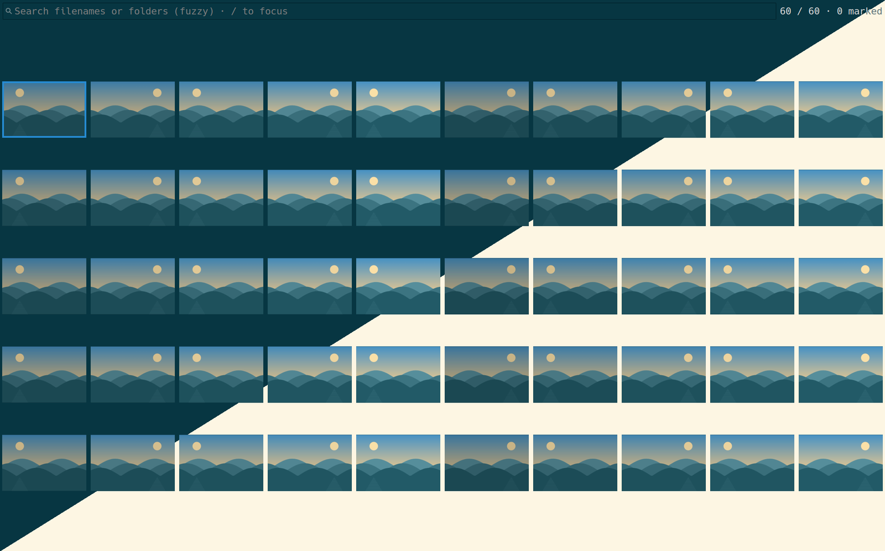
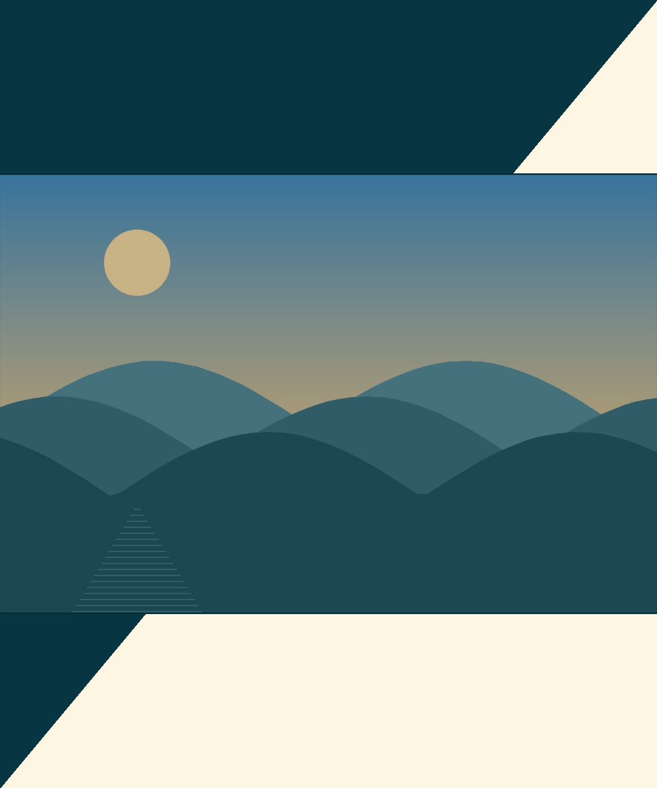

# Media Browser

A local mixed photo/video gallery with a Rust controller, a pinned private pqiv
renderer, and mpv playback. Production execution uses Rust and C/GTK; Python is
used only by the development acceptance suite.

```sh
media-browser [folder-or-file ...]
```

With no argument, browse `~/Pictures`, falling back to HOME. Discovery is
recursive and naturally sorted; passing a file includes its sibling media.
Gallery and photo windows start as ordinary, non-ontop X11 clients. Enter
opens the current original in a separate viewer and preserves the gallery.
Window placement and tiling are handled by your window manager.

## Screenshots

### Thumbnail browser



### Photo viewer



The screenshots use generated demo media. Each image combines matching captures
in dark (upper-left) and light (lower-right) GTK themes along a diagonal seam.

## Controls

| Keys | Gallery | Photo viewer |
| --- | --- | --- |
| `h/j/k/l`, arrows | Move the cursor | Pan (`h/j/k/l`) |
| `Ctrl+D/U`, Page Down/Up | Move one page | Next/previous (`Ctrl+D/U`) |
| `gg` / `G`, Home/End | First/last item | — |
| `0` / `$` | First/last tile in the current row | — |
| `f` | Native quick-jump labels using `asdfghjkl` | Fullscreen |
| `/` | Focus the fuzzy media-search box | — |
| `zi` / `zo` | Enlarge/shrink tiles | Zoom image |
| `v` | Start/stop a visual range | — |
| Escape | Stop the range, preserving marks | Close this viewer |
| `u` | Clear every mark and stop selection | — |
| `d` | Confirm moving marked originals, or current original, to Trash | — |
| Enter | Open one current item when no selection/marks remain | — |
| `n` / `p` | — | Next/previous sibling photo |
| Tab | — | Close this viewer |
| `q` | Quit the application and its owned processes | Close this viewer |
| `?` | Show effective shortcut help | Show effective shortcut help |
| `y` | Copy current original image to the clipboard | Copy the currently browsed original image |
| `Y` | Copy current original full path as text | Copy the currently browsed original full path |

`zi` means press z then i. Tile sizes are 64, 96, 128, 192, **256 default**,
and 384 pixels, clamped at both ends. A normal click selects; double-click
activates the selected original.

The search box filters filenames and relative folder paths as you type. Matching
is case-insensitive and fuzzy: `alp mrn` matches `Alpine Morning.jpg`. Results
retain their natural order. Press `/` to focus the box; Enter or Escape returns
to the grid without opening an item or clearing the query. Clear the box to show
all items again. While typing, gallery shortcut letters are ordinary text.

Filtering stops an active visual range but preserves every mark, including marks
hidden by the query. The status shows matching/total items and marked/hidden
counts. Hidden marks still block Enter and participate in batch Trash operations;
`u` clears them along with visible marks. Navigation and new visual ranges follow
the filtered results, while viewing, copying and Trash use original files.

`?` opens a GTK dialog with Gallery and Photo tabs and a focused fuzzy-search box.
Shortcuts are grouped by action and read from the effective native keymap,
including user overrides. Type a query such as `cpimg` or `copy path` to filter
keys, actions and sections. Tab focuses the list, where `j`/`k` scroll and `/`
returns to search. These letters remain ordinary text in the search box.
Escape or Close dismisses help; `?` and q also close it outside the input box.
The current cursor, range and marks are preserved.

`y` copies full-resolution image pixels (with embedded orientation applied) to
the standard clipboard, including `image/png`. Switch to an
image-paste-capable application and use Ctrl+V. This copies the original image,
not a thumbnail, screenshot, zoomed crop, video poster or themed canvas. Alpha is
preserved. Copy operates on the current item even when marks remain; it does not
copy a batch. `Y` copies its original absolute path, including for videos.
Image copying is for still photos; mpv's controls/configuration remain its own.

The gallery retains clipboard ownership for copies made in photo viewers, so
closing just the photo viewer keeps the image available. Keep the gallery open
for pasting; after exiting the whole application, persistence depends on your
X11 clipboard manager. A decoding/read error leaves the previous clipboard
contents intact and reports the failure.

Visual ranges grow and shrink with navigation. Escape preserves marks; another
range can be added elsewhere. Enter is disabled while a range is active or any
marks remain, including after Escape and cancelled confirmations.

Trash confirmation defaults to **No**. Press y to confirm, or n/Escape to
cancel; Enter and closing the dialog cancel too. One through five originals are
listed by full path; larger batches show their count. GIO supplies Freedesktop
Trash and restoration metadata, including per-filesystem handling. Failures
are reported, with failed items retained; there is no permanent-delete fallback.
The empty gallery remains open until q.

**mpv follows its normal system/user configuration and scripts.** Media Browser
does not install an mpv keymap or pass an input-conf override or window-mode
policy to mpv.

Animated GIFs have visible-frame posters and open in mpv so they play. Single-
frame GIFs remain ordinary photos. GIF detection uses file contents, including
extensionless or renamed files. GIF thumbnails carry a small translucent dotted
circle at bottom-right; videos use a play triangle.

## Build and package (Arch Linux)

Install `base-devel` and build as an ordinary user. All other build and runtime
dependencies are declared in `PKGBUILD` and can be installed by makepkg:

```sh
bash tools/package.sh --syncdeps
```

The script stages makepkg's flat source inputs under `.build/package`, keeping
its `src/` separate from the Rust source directory. It runs the locked release
build, unit tests, native renderer build, package construction and corresponding
source-package generation. Install the resulting package with pacman, e.g.:

```sh
sudo pacman -U "$(makepkg --dir .build/package --packagelist)"
```

The generated full source package is independently buildable with ordinary
`makepkg -s` after extraction. Package builds use their own Cargo cache and
fixed `/usr` installation paths; they do not use a developer's home helpers,
Python environment, dotfiles, themes or media. Runtime code is Rust/C, with no
Python interpreter or venv requirement. Optional user configuration is loaded
only when the installed application runs. An X11 display is required for GUI
execution; a particular window manager or compositor is not required.

There is one package containing both executables; the distribution pqiv package
is independent.

Release builds also retain a Rust dependency-source archive (including the
dependency license files) and `SHA256SUMS`, alongside makepkg's full source
package containing the pinned pqiv repository, Rust sources and native patch.

| Installed path | Purpose |
| --- | --- |
| `/usr/bin/media-browser` | Rust application |
| `/usr/lib/media-browser/pqiv` | Private pinned/patched renderer, for gallery and photos |
| `/usr/share/media-browser/` | Packaged configuration and keybindings |
| `/usr/share/licenses/media-browser/` | Project license and upstream GPL text |

See [renderer provenance](renderer/README.md) for the exact source pin, native
patch, backends and upgrade policy. Private pqiv version/API isolation does not
freeze GTK, GIO, GdkPixbuf or codec libraries. Rebuild against current Arch after
ABI transitions and bump `pkgrel`; pacman cannot rebuild a local package for you.

## Configuration

Packaged defaults are loaded first. Optional user overrides live under
`$XDG_CONFIG_HOME/media-browser` (normally `~/.config/media-browser`):

- `config.toml`: `thumbnail_size = 256`, using one of the supported sizes.
- `pqivrc`: pqiv `[keybindings]` overrides, using native renderer actions.

Pacman owns no home-directory configuration. The app resolves its renderer and
resources by fixed installed paths rather than PATH lookup.
Changing a keybinding to a normal pqiv action is an explicit user customization;
the packaged gallery bindings keep original-file operations in the controller.

## GTK appearance

The gallery, photo canvas, selection/quick-jump colors, loading tiles and GTK
dialogs follow the active **GTK 3 system theme**, including Solarized light/dark.
The renderer does not force a dark variant or install its own theme. Changes to
the system GTK theme redraw UI colors while the app is open, without decoding
media again or invalidating populated gallery tiles. Actual media pixels and
clipboard images are not recolored by the UI theme.

The X11 instances are `media-browser-gallery` and `media-browser-viewer`, so
window-manager rules can distinguish these windows from other image viewers.

## Cache and process model

512-pixel PNG masters live in
`$XDG_CACHE_HOME/media-browser/thumbnails/posters`. The cache preserves the
private MD5-of-unescaped-file-URI namespace and PNG metadata.
Fingerprints include URI/path, byte size, device, inode and nanosecond mtime/ctime.
New PNG metadata uses escaped ASCII URIs so Unicode filenames remain reusable;
the existing private cache filename hashes and valid legacy metadata are retained.
Videos get a small translucent play badge at bottom-right; GIFs get a dotted
circle. Old animated GIF posters are regenerated once under the current
visible-frame/badge cache version. Valid unbadged still-GIF and video posters
are upgraded without decoding their sources again.

Two workers prioritize the actual renderer viewport and at most one adjacent
page in the direction of travel. Jumps replace the queue and cancel obsolete
decoders. Only this bounded window is periodically checked. Size changes reuse
masters. Cache and session PNGs publish atomically after source validation;
each completion reloads one stable catalog ID. No background completion clears
the whole montage. Native input/viewport events and cursor-stable marking use
inherited pipes, without per-key interpreters or global input observation.

FFmpeg/ffprobe children have cancellation and deadlines. Application shutdown
joins workers, reaps its viewers, closes pipes and removes its private runtime
directory. `MEDIA_BROWSER_TRACE=/path/to/log.jsonl` enables optional diagnostics
for cursor/mark state, actual viewport, worker counters and original mappings;
it also enables read-back of actual GTK dialog/photo state for acceptance tests.

## Verification

```sh
cargo fmt --check
cargo clippy --locked --all-targets -- -D warnings
cargo test --locked
docker build -t media-browser-gui -f ci/Dockerfile .
mkdir -p artifacts
docker run --rm --init --network none --shm-size=512m \
  -v "$PWD/artifacts:/artifacts" media-browser-gui \
  --artifacts /artifacts/run --geometry 2880x1800 --compositor picom
```

The artifact directory must be writable by container UID 1000. Repeat with
1024x768 and without Picom. Tests run installed binaries in a fresh Arch runtime,
private D-Bus/Xvfb/Awesome, private HOME/XDG directories and synthetic media.
Audio decoding uses mpv's null audio output. It is not a physical-speaker test.
Missing dependencies or failed/unexecuted required scenarios fail the job.

[Testing and acceptance coverage](tests/README.md) documents the development
checks and GUI scenarios. CI builds the package, installs
that exact artifact in four geometry/compositor combinations, and uploads logs,
screenshots, recordings, WM measurements, mpv IPC evidence and work counters.
Tagged releases depend on both package and GUI jobs.

## License

Project and renderer integration: **GPL-3.0-or-later**.
pqiv retains its upstream GPL-3.0-or-later notices and full source provenance.
